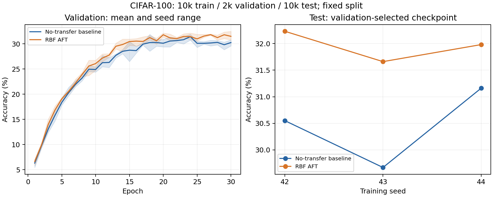

# AFT 延长训练与多随机种子实验

预先固定30 epochs、训练种子42/43/44、拆分种子42。全部三组完成后汇总，不按结果挑种子。

| Seed | Baseline测试 | AFT测试 | AFT − baseline | 最佳epoch：baseline / AFT |
|---|---:|---:|---:|---:|
| 42 | 30.55% | 32.23% | +1.68 pp | 18 / 30 |
| 43 | 29.67% | 31.66% | +1.99 pp | 24 / 29 |
| 44 | 31.16% | 31.98% | +0.82 pp | 24 / 29 |

测试准确率均值±跨种子样本标准差：baseline **30.46% ± 0.75 pp**，AFT **31.96% ± 0.29 pp**。配对差均值 **+1.50 pp**，差值样本标准差0.61 pp。标准差不是均值置信区间。

三种子的准确率差均为正：+1.68、+1.99、+0.82个百分点。但AFT测试交叉熵在三个种子中均更高（更差）：3.476/3.391/3.601，对应baseline为2.965/3.221/3.375。准确率改善不代表概率预测质量全面改善；本轮事先按验证准确率选模。

## 怎样理解

延长训练对两组成绩均有明显帮助，说明5-epoch试验不足以评价这一配置的充分训练效果。但延长训练的收益和迁移本身的收益是两个问题：迁移收益必须看同一个种子下AFT与baseline之差。三个种子仍然是小样本，不能据此保证其他设置/数据/种子上的稳定优势。

训练后期训练准确率继续上升，但验证成绩出现回落，因此按各自验证准确率最高的checkpoint选模，不能直接使用最后一轮训练准确率。未根据测试集挑epoch或修改beta/sigma。此前已查看过相同官方测试集，本轮属于探索性复核，不是全新盲测。

## 协议与证据

- 固定CIFAR-100分层10,000张训练、2,000张验证、官方10,000张测试；3个种子使用同一拆分。每个种子的两组使用相同初始化、批次顺序、学习率与训练步数。改变的是初始化及训练顺序种子，未把拆分变化混入种子方差。
- 每组30 epochs，Adam学习率0.001，batch64，无增强；ImageNet ResNet-18教师、相同小型CNN学生、最后stage、RBF sigma=1，AFT beta=1，baseline beta=0。其余设置同前次5-epoch试验。
- 每组按验证集选checkpoint，完整测试集评估一次；共6个训练运行。未调参后挑最好种子。
- Apple MPS，PyTorch 2.14.1。deterministic warn_only，不承诺跨平台逐位复现。seed42 baseline前5轮指标与前次保存结果完全相同。
- 教师缓存及checkpoint保留在本地runs/extended-30ep-seed*/；reports/extended_30ep内保留汇总、全部曲线及证据文件哈希。summarize_extended.py重新从逐样本预测计数并验证三组拆分一致。



## 复现命令

```bash
for seed in 42 43 44; do
  python run_pilot.py --device mps --epochs 30 --seed "$seed" --output "runs/extended-30ep-seed$seed"
done
python summarize_extended.py
```

已有输出目录会被拒绝覆盖。先按README准备数据与依赖，首次使用会下载教师权重。完整50,000官方训练图片中的38,000张仍未用于本轮；不要宣称完成标准全训练集benchmark。

## 简历取舍

可写实现特征迁移、建立无迁移对照、按验证选模和多种子评估，不把单个最好成绩或训练准确率包装成稳定提升。原课程与2026复现分开标注；新运行由助手协助完成，需要理解方法、代码和实验限制后才能在面试中承担相应陈述。
